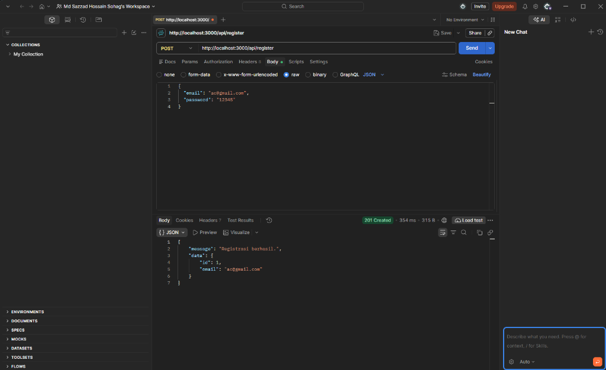
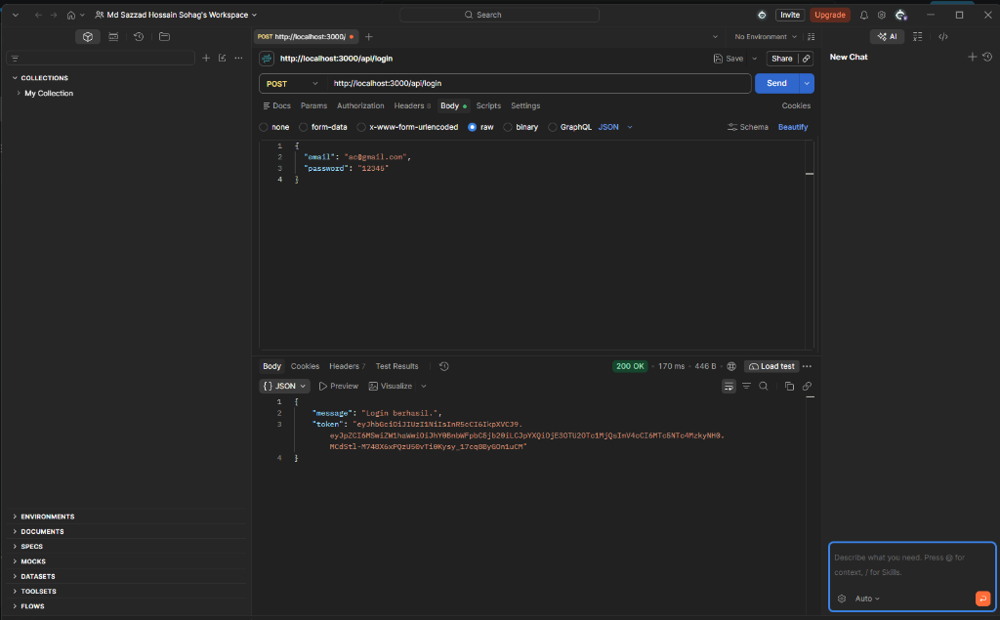
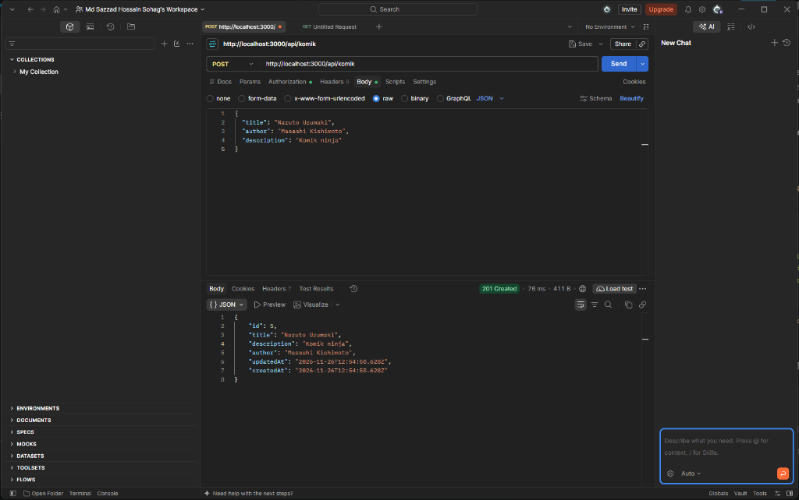
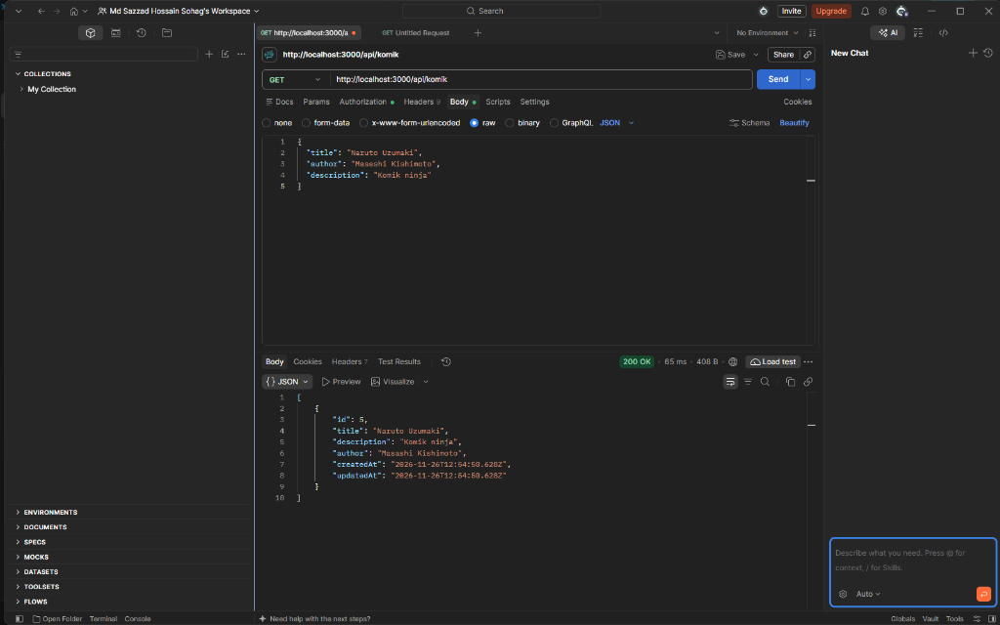
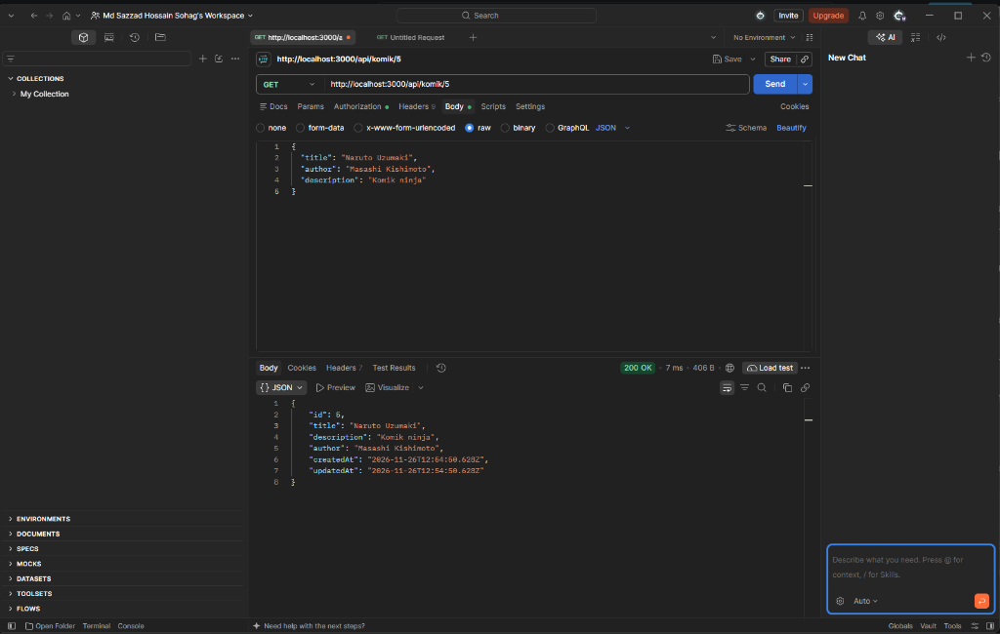
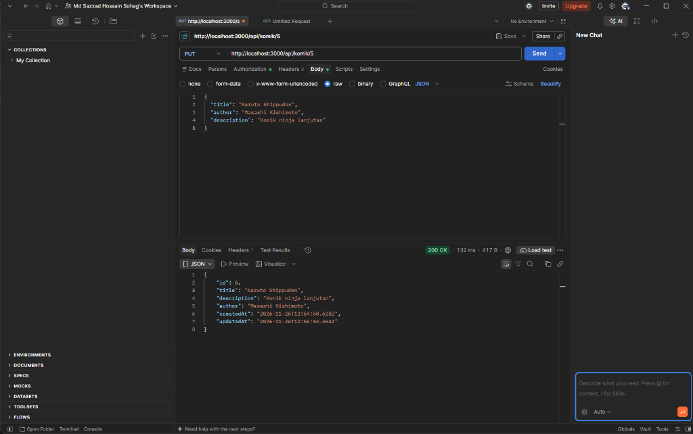
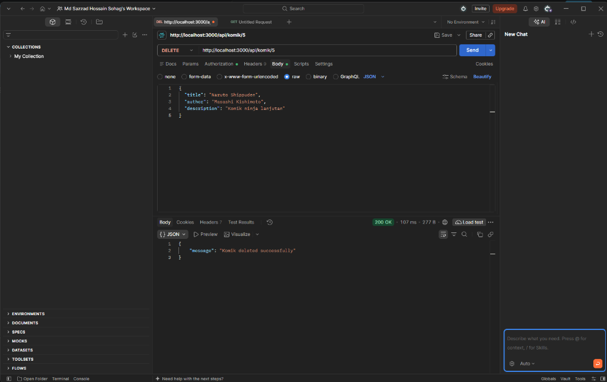

# Komik REST API (Express + Sequelize + PostgreSQL + JWT)

REST API for managing comic books (`Komik`) with user authentication using **bcrypt** password hashing and **JSON Web Tokens (JWT)**, built with Node.js, Express, Sequelize ORM, and PostgreSQL.

## Project Structure

```text
.
├── config/
│   ├── config.js           # Sequelize database configuration from environment variables
│   └── db.js               # Database authentication & sync helper
├── controller/
│   ├── komikController.js  # CRUD handlers for Komik
│   └── userController.js   # Register & login handlers
├── middleware/
│   └── authMiddleware.js   # Bearer JWT verification middleware
├── migrations/
├── models/
│   ├── index.js            # Sequelize model loader
│   ├── komik.js            # Komik model
│   └── user.js             # User model
├── routes/
│   └── api.js              # Public and protected API routes
├── seeders/
├── services/
│   ├── hashService.js      # Bcrypt password hashing & comparison service
│   └── jwtService.js       # JWT generation & verification service
├── .env.example            # Environment variable template
├── .gitignore
├── .sequelizerc
├── index.js                # Express server entry point
└── package.json
```

## Services

- **`services/hashService.js`**:
  - `hashPassword(password)` — hashes plaintext passwords using `bcrypt` with 10 salt rounds.
  - `comparePassword(password, hashedPassword)` — verifies a plaintext password against a stored hash.
- **`services/jwtService.js`**:
  - `generateToken(payload)` — signs a JWT using `JWT_SECRET` and `JWT_EXPIRES`.
  - `verifyToken(token)` — verifies and decodes a JWT using `JWT_SECRET`.

## Setup & Installation

1. **Install dependencies:**
   ```bash
   npm install
   ```
2. **Create PostgreSQL database:**
   Create a PostgreSQL database named `perpustakaan` (or match `DB_DATABASE` in `.env`).
3. **Configure environment variables:**
   Copy `.env.example` to `.env` and update `DB_PASS` with your PostgreSQL password:
   ```env
   DB_USER=postgres
   DB_PASS=your_database_password
   DB_DATABASE=perpustakaan
   DB_HOST=127.0.0.1
   DB_PORT=5432
   DB_DIALECT=postgres

   JWT_SECRET=mySuperSecretKey123
   JWT_EXPIRES=1d
   ```
4. **Run the server:**
   ```bash
   npm start
   ```
   The API will run at `http://localhost:3000`.

## API Endpoints

| Method | Endpoint | Access | Description |
| --- | --- | --- | --- |
| `POST` | `/api/register` | Public | Register a new user |
| `POST` | `/api/login` | Public | Authenticate user and return JWT |
| `GET` | `/api/komik` | Public | Get all komik |
| `GET` | `/api/komik/:id` | Public | Get a komik by ID |
| `POST` | `/api/komik` | Protected (Bearer Token) | Create a new komik |
| `PUT` | `/api/komik/:id` | Protected (Bearer Token) | Update a komik by ID |
| `DELETE` | `/api/komik/:id` | Protected (Bearer Token) | Delete a komik by ID |

## Postman Testing Screenshots

### 1. Register (`POST /api/register`)
Registers a new user (`ac@gmail.com`) by hashing the password with `hashService` (`bcrypt`) and returns `201 Created` with the created user ID and email.



### 2. Login (`POST /api/login`)
Verifies user credentials against the hashed password via `hashService` and returns `200 OK` along with a signed JWT token generated by `jwtService`.



### 3. Create Komik (`POST /api/komik`)
Protected endpoint using the JWT Bearer Token; creates a new comic record (`Naruto Uzumaki`, ID `5`) and returns `201 Created`.



### 4. Get All Komik (`GET /api/komik`)
Public endpoint that retrieves all comic records from PostgreSQL and returns `200 OK` with a JSON array.



### 5. Get Komik by ID (`GET /api/komik/:id`)
Public endpoint that fetches a single comic record by ID (`/api/komik/5`) and returns `200 OK`.



### 6. Update Komik (`PUT /api/komik/:id`)
Protected endpoint using the JWT Bearer Token; updates comic ID `5` to `Naruto Shippuden` and returns `200 OK` with the updated data.



### 7. Delete Komik (`DELETE /api/komik/:id`)
Protected endpoint using the JWT Bearer Token; deletes comic ID `5` and returns `200 OK` with a confirmation message.


